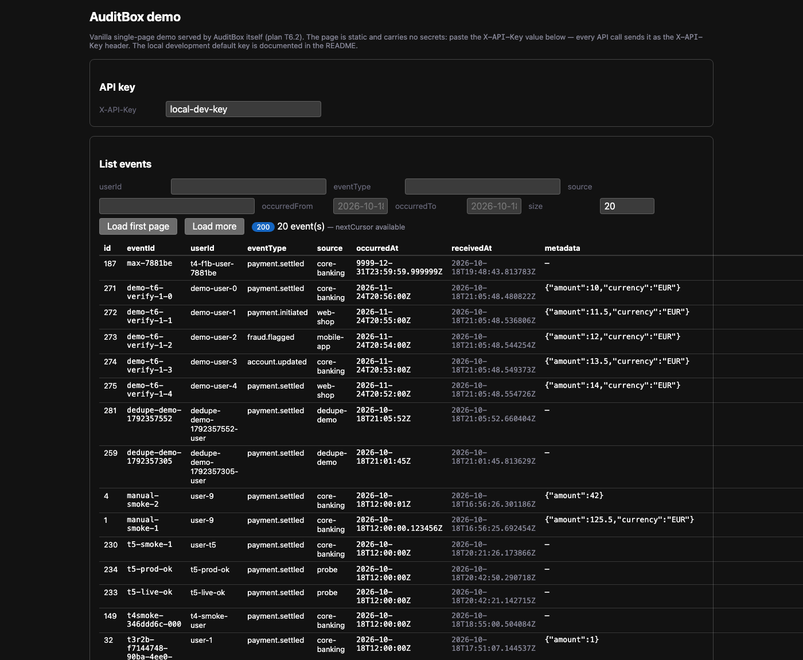

# AuditBox

A small Spring Boot service that accepts transaction/event history over HTTP, stores it in
PostgreSQL, and serves it back with filters and stable keyset pagination — written as a
provable reference implementation: every documented behavior is backed by a test or a real
transcript.

Created in [T3 Code](https://t3.codes). Roadmap and status: [docs/plan.md](docs/plan.md).

[](https://github.com/kemselcuk/auditbox/actions/workflows/ci.yml)

## Overview

- **Ingestion** (`POST /api/v1/events`) is idempotent per client-generated `eventId`: an
  identical retry returns `200` with the stored record, different content on the same
  `eventId` is rejected with `409` — including under concurrency (20 identical parallel
  requests produce exactly one row).
- **Listing** (`GET /api/v1/events`) filters by `userId`, `eventType`, `source` and
  `occurredAt` range, orders newest first, and pages with an opaque keyset cursor. Each page
  request is a single `SELECT` capped at `size + 1` rows; there is no total count, and pages
  are stable under concurrent inserts.
- **Single fetch** (`GET /api/v1/events/{eventId}`) returns one stored record, or `404`
  Problem Details for an unknown `eventId`.
- **Metrics**: Micrometer counters for created/replayed/conflicted events, failed API-key
  checks and rate-limit rejections, exposed through the key-protected `/actuator/metrics`
  endpoint.
- **Correlation**: every request gets an `X-Request-Id` (echoed from a safe incoming value or
  generated), carried in the response header and the MDC of every log line; `prod` logs ECS
  JSON to the console.
- **Authentication** is a static `X-API-Key` header matched against a registry of per-source
  SHA-256-hashed keys (`API_KEYS`) with a constant-time comparison; the server never stores
  plaintext keys; `prod` refuses to start without a configured registry.
- **OpenAPI** descriptions exist for all endpoints (`/v3/api-docs`), served only in the
  `dev`/`test` profiles.

The full behavior statement is [docs/plan.md](docs/plan.md); the rationale behind each choice
is [docs/decisions.md](docs/decisions.md) (D1–D23).

## What this is / is not

AuditBox **records what it receives**; nothing more is claimed about history:

- It is **not** a tamper-proof or immutable ledger — stored rows are ordinary PostgreSQL rows
  and can be updated or deleted like any other database row; the content hash documents
  content identity, and protects nothing.
- It is the only service in this repository (no event platform, no sidecar), and the
  PostgreSQL database is the only data store, with a single `events` table.
- There is no total-count API and no offset pagination (rejected alternatives, D3); no event
  platform such as Kafka and no sidecar service (scope: `AGENTS.md`, this plan).

## Architecture

One Spring Boot application, one PostgreSQL database, one `events` table:

```
            ┌────────────────────────────────────────────────────────────────┐
 client ───▶│ HTTP  :8080                                                    │
  (curl,    │                                                                │
  demo app, │   X-API-Key filter ──▶ EventController                         │
  browser)  │   (constant-time             │  /api/v1/events                  │
  page)     │    SHA-256/                  │                                  │
            │    MessageDigest)            ├─▶ POST: validation → canonical   │
            │                              │   content hash (SHA-256)         │
            │                              │   → per-eventId advisory lock    │
            │                              │     (first statement, D21)       │
            │                              │     → pre-check stored row /     │
            │                              │       single-transaction insert  │
            │                              │       → 201 / 200 / 409          │
            │                              │                                  │
            │                              └─▶ GET: parse/validate query      │
            │                                  → keyset Specification query   │
            │                                    (one SELECT, size + 1 cap,   │
            │                                     opaque base64url cursor)    │
            │                                                                │
            │   Flyway ──▶ V1: events table; V2: monthly RANGE-              │
            │                partitioned on occurred_at (D21)                │
            │   springdoc (dev/test profiles only) ──▶ /v3/api-docs, /swagger-ui │
            └───────────────┬────────────────────────────────────────────────┘
                            │ JDBC
                            ▼
                PostgreSQL (container, host port 5432 or DB_PORT)
                single logical table `events`, monthly RANGE-partitioned (D21):
                  id (identity), event_id, user_id, event_type, source,
                  occurred_at TIMESTAMPTZ, received_at TIMESTAMPTZ (server,
                  default now()), metadata JSONB NULL, content_hash TEXT,
                  created_at TIMESTAMPTZ (default now());
                  partitions events_YYYY_MM = [month start UTC, next month
                  start UTC) + events_default for every occurredAt of the
                  documented API range outside the managed window;
                  indexes: unique uq_events_event_id (occurred_at, event_id;
                  global eventId uniqueness via the app advisory lock, D21),
                  (occurred_at DESC, event_id DESC), event_id,
                  user_id, event_type, source
```

Components (source layout under [src/main/java/io/auditbox](src/main/java/io/auditbox)):

| Package | Role |
|---|---|
| `config` | Spring Security filter chain: `ApiKeyAuthenticationFilter` + per-source `ApiKeyRegistry` (constant-time digest comparison), `ApiKeyProdRequirement` fail-fast guard, entry point returning Problem Details, `RateLimiter`/`RateLimitFilter` (per-source 429s) |
| `events` | `EventController` (POST/GET), `EventService`/`EventWriteService` (write path and idempotency race), `EventQueryService` (read path, keyset), `EventContentHasher` (canonical hash), `EventCursor` (opaque cursor codec), validators, Problem Details advice |
| `retention` | `PartitionMaintenanceService` + `PartitionMaintenanceScheduler`: keeps the monthly partition window healthy and applies retention (M11.2, D22) — startup pass + daily cron, lookahead partition creation, retention drops, bounded `events_default` deletes |
| `demo` | sample-event client and load generator (JDK only, T6.1/T11.3) |

The browser demo page is a static resource ([src/main/resources/static/demo](src/main/resources/static/demo/index.html))
served by the app itself.

### Retention and partitions (D22)

The monthly window of [M11.1](#architecture) is maintained automatically by one job: it
runs **once at application startup** (after Flyway, so the schema exists) and then
**daily at 03:30 server time** (configurable). One pass does three things:

1. **Ensures the lookahead window** — for every month from the current month (UTC)
   through `RETENTION_LOOKAHEAD_MONTHS` months ahead, a missing `events_YYYY_MM`
   partition is created with the standard bounds `[month start UTC, next month start
   UTC)`, so the DEFAULT partition stays the (small) exception. The DDL is built only
   from clock-derived months; an existing partition is never recreated (the pass is
   idempotent).
2. **Applies retention by dropping** — every monthly partition whose upper bound is
   `<=` now(UTC) − `RETENTION_MONTHS` is dropped. **Dropping a partition removes its
   rows with the table, by design: this delete IS the retention policy.** A partition
   overlapping the window is kept; one whose upper bound is exactly the cutoff is
   dropped (documented `<=` rule); the decision reads the real partition bounds from
   the PostgreSQL catalog, never just the name.
3. **Cleans the DEFAULT partition in bounded batches** — rows older than the same
   cutoff are deleted from `events_default` in batches of
   `RETENTION_DEFAULT_DELETE_BATCH_SIZE` rows, at most `RETENTION_MAX_BATCHES_PER_RUN`
   batches per pass, so one pass never runs an unbounded DELETE. Monthly partitions
   never see the DELETE.

Configuration (`auditbox.retention.*`, env names in parentheses, defaults in
`application.yml` and [.env.example](.env.example); an invalid value aborts startup
naming the property — no clamping):

| Property | Env | Default | Meaning |
|---|---|---|---|
| `enabled` | `RETENTION_ENABLED` | `true` | `false` makes the job a strict no-op (no DDL, no deletes, no counters) |
| `months` | `RETENTION_MONTHS` | `24` | Retention window in months (≥ 1 when enabled) |
| `lookahead-months` | `RETENTION_LOOKAHEAD_MONTHS` | `3` | Months ahead the job keeps pre-created (≥ 0 when enabled) |
| `default-delete-batch-size` | `RETENTION_DEFAULT_DELETE_BATCH_SIZE` | `1000` | Rows per DELETE batch on `events_default` |
| `max-batches-per-run` | `RETENTION_MAX_BATCHES_PER_RUN` | `10` | Per-pass cap on those batches |
| `schedule-cron` | `RETENTION_CRON` | `0 30 3 * * *` | Spring cron of the daily pass |

The pass increments the untagged counters `auditbox.retention.partitions.created`,
`auditbox.retention.partitions.dropped` and `auditbox.retention.default.rows.deleted`
(see [Observability](#observability)). Full rationale, including the **single-instance
caveat** (every replica would run the job — disable it or stagger the cron on extra
replicas): [docs/decisions.md](docs/decisions.md) D22.

## Getting started

Prerequisites: Java 21 LTS (build target `maven.compiler.release=21`; verified with
Temurin 21.0.8), Docker with the Compose plugin (`docker compose`). No secrets are needed —
every variable has a safe local default (see [.env.example](.env.example)).

### 1. Start the database

```bash
DB_PORT=5433 docker compose up -d db
```

`docker compose ps` then shows the container as healthy:

```text
NAME          IMAGE                COMMAND                  SERVICE   CREATED        STATUS                PORTS
auditbox-db   postgres:18-alpine   "docker-entrypoint.s…"   db        8 seconds ago  Up 8 seconds (healthy)   0.0.0.0:5433->5432/tcp, [::]:5433->5432/tcp
```

> The default host port is 5432 (`DB_PORT` in [.env.example](.env.example)). On the machine
> this output was produced on, 5432 was already used by a host PostgreSQL, so the run used
> `DB_PORT=5433`. If 5432 is free on yours, omit the variable and the port everywhere below.

### 2. Run the application (local profile)

```bash
DB_PORT=5433 ./mvnw spring-boot:run -Dspring-boot.run.profiles=local
```

Expected startup on a second run (abridged real output; the first run on an empty volume also
logs `<< Empty Schema >>` and `Migrating schema "public" to version "1 - create events"`):

```text
... org.flywaydb.core.FlywayExecutor         : Database: jdbc:postgresql://localhost:5433/auditbox (PostgreSQL 18.6)
... o.f.core.internal.command.DbValidate     : Successfully validated 1 migration (execution time 00:00.014s)
... o.f.core.internal.command.DbMigrate      : Current version of schema "public": 1
... o.s.boot.tomcat.TomcatWebServer          : Tomcat started on port 8080 (http) with context path '/'
... io.auditbox.AuditBoxApplication          : Started AuditBoxApplication in 2.348 seconds (process running for 2.542)
```

Flyway applies `V1__create_events.sql` (events table) and `V2__partition_events.sql` (M11.1:
converts it to a monthly RANGE-partitioned table on `occurred_at`, decision D21) on first
start; later starts validate the migrations and report that the schema is up to date.

### 3. First request

```bash
curl http://localhost:8080/actuator/health
```

```text
{"groups":["liveness","readiness"],"status":"UP"}
```

`/actuator/health` is public (compose-style health checks), and so is the static demo page
under `/demo/**` (no secrets — see [Demo](#demo)). Every API path requires the static
`X-API-Key` header (see [Authentication](#authentication)). With the `local` profile the key
has the safe default `local-dev-key` — see [API](#api) below for the first POST.

### 4. Stop

- Application: `Ctrl-C`
- Database, keeping data: `docker compose down`
- Database, deleting data: `docker compose down -v`

### Full stack in one command (optional app container)

Instead of running the app on the host, you can start database + application together as
containers (the `app` service is opt-in behind the `app` compose profile; the default
`docker compose up -d db` workflow is unchanged):

```bash
DB_PORT=5433 docker compose --profile app up --build -d
```

`DB_PORT` only selects the database's **host** port (omit it when 5432 is free); the app
container always reaches the database at `db:5432` inside the compose network. This builds the
Docker image, starts `db` and waits for its health check before starting the app. When the app
is up:

```bash
curl http://localhost:8080/actuator/health   # {"groups":["liveness","readiness"],"status":"UP"}
```

The same `local` profile defaults apply inside the container: the database connection uses the
same `DB_NAME`/`DB_USER`/`DB_PASSWORD` defaults as the `db` service (`auditbox`, override via
`DB_HOST`/`DB_PORT`/`.env`), and the API key defaults to `local-dev-key` (via its SHA-256
digest in `API_KEYS`, see [Authentication](#authentication)) — override with `API_KEYS` in
`.env` for anything reachable by others:

```bash
curl -sS -i -H "X-API-Key: local-dev-key" http://localhost:8080/api/v1/events \
  -H 'Content-Type: application/json' \
  -d '{"eventId":"...","userId":"user-42","eventType":"payment.settled",
       "source":"core-banking","occurredAt":"2026-10-18T12:00:00Z"}'
```

Stop the full stack, keeping data: `docker compose --profile app down`. Delete data as well:
`docker compose --profile app down -v`.

## API

All endpoints live under `/api/v1/events` and require the API key. Machine-readable OpenAPI
is served at `/v3/api-docs`, the UI at `/swagger-ui/index.html` — both **disabled by default**
(D5); enable them with the dev profile, e.g.
`./mvnw spring-boot:run -Dspring-boot.run.profiles=local,dev`. Documentation requires the API
key like every other non-public endpoint — the only public paths are `/actuator/health/**`
and the static demo page under `/demo/**`.

> A plain browser visit of the Swagger UI cannot attach the `X-API-Key` header, so the UI
> answers `401` and will not load. Open it through a header-capable client (a browser
> extension or a local proxy adding the header), or fetch the machine-readable document
> directly:
>
> ```bash
> curl -sS -H "X-API-Key: local-dev-key" http://localhost:8080/v3/api-docs
> ```

### Record an event (POST)

`POST /api/v1/events` — idempotent per `eventId` (D4). Body: `eventId` (client-generated, max
128 chars), `userId`, `eventType`, `source`, `occurredAt` (strict ISO-8601 with offset, within
`0001-01-01T00:00:00Z..9999-12-31T23:59:59.999999Z`), optional `metadata` (any JSON value).
`receivedAt` is set by the server.

```bash
curl -sS -i -H "X-API-Key: local-dev-key" http://localhost:8080/api/v1/events \
  -H 'Content-Type: application/json' \
  -d '{"eventId":"eb5a3a10-6d2d-4df1-9e3a-1e5a0b2c3d40","userId":"user-42",
       "eventType":"payment.settled","source":"core-banking",
       "occurredAt":"2026-10-18T12:00:00Z"}'
```

Real response (new event):

```text
HTTP/1.1 201
{"id":761,"eventId":"eb5a3a10-6d2d-4df1-9e3a-1e5a0b2c3d40","userId":"user-42",
 "eventType":"payment.settled","source":"core-banking","occurredAt":"2026-10-18T12:00:00Z",
 "metadata":null,"receivedAt":"2026-10-18T21:40:17.857688Z"}
```

Status semantics (all bodies carry the stored/event record; the internal `content_hash` is
never exposed):

- `201 Created` — new event stored.
- `200 OK` — idempotent retry: same `eventId` with identical content (equivalent spellings
  hash identically, e.g. a different UTC offset, a different JSON key order, `100` vs `100.0`).
  The body is the stored record.
- `409 Conflict` — same `eventId` with different content. Problem Details with the stored
  record in the `existingEvent` extension; nothing is overwritten:

```text
HTTP/1.1 409
{"detail":"an event with eventId 'eb5a3a10-6d2d-4df1-9e3a-1e5a0b2c3d40' already exists with different content","instance":"/api/v1/events","status":409,"title":"Conflict","existingEvent":{"id":761,"eventId":"eb5a3a10-6d2d-4df1-9e3a-1e5a0b2c3d40","userId":"user-42","eventType":"payment.settled","source":"core-banking","occurredAt":"2026-10-18T12:00:00Z","metadata":null,"receivedAt":"2026-10-18T21:40:17.857688Z"}}
```

`400 Bad Request` — validation failures as Problem Details with an `errors` extension (one
`(field, message)` pair per violation, sorted by field):

```text
HTTP/1.1 400
{"detail":"Request validation failed","instance":"/api/v1/events","status":400,"title":"Bad Request","errors":[{"field":"eventId","message":"eventId must not be blank"},{"field":"occurredAt","message":"occurredAt must be a strict ISO-8601 date-time with a UTC offset (Z or +/-hh:mm) between 0001-01-01T00:00:00Z and 9999-12-31T23:59:59.999999Z, e.g. 2026-10-18T12:00:00Z"},{"field":"userId","message":"userId must not be blank"}]}
```

Beyond Bean Validation, `400` also covers unreadable request parts: malformed JSON returns a
generic Problem Details detail (the `errors` extension is reserved for Bean Validation),
oversized or huge-exponent metadata numbers are bounded by a validator (`400` never `500`), and
NUL characters or numeric data PostgreSQL rejects (SQLState class 22) return a generic detail.
Unexpected errors are a generic `500` Problem Details without internals; the server logs them.

### List events (GET)

`GET /api/v1/events` — filters and stable keyset pagination (D3):

- Filters (optional, exact match): `userId`, `eventType`, `source`; a blank value counts as no
  filter. `occurredFrom`/`occurredTo` are inclusive bounds, strict ISO-8601 with offset, inside
  the same supported range as `occurredAt`.
- Pagination: newest first (`occurredAt DESC, eventId DESC`). Echo the previous response's
  `nextCursor` verbatim as `cursor`; `nextCursor` is only set when more results exist and is
  null on the last page. `size` is 1..100 (default 20). There is deliberately no total count;
  a page request is a single SELECT of at most `size + 1` rows.
- Errors: `400 Bad Request` Problem Details for a malformed cursor, a non-ISO-8601 or
  out-of-range bound, an inverted range or an out-of-range `size` — the detail names the
  offending parameter.

```bash
curl -sS -H "X-API-Key: local-dev-key" 'http://localhost:8080/api/v1/events?userId=user-42&size=10'
```

Real response:

```text
{"items":[{"id":761,"eventId":"eb5a3a10-6d2d-4df1-9e3a-1e5a0b2c3d40","userId":"user-42",
 "eventType":"payment.settled","source":"core-banking","occurredAt":"2026-10-18T12:00:00Z",
 "metadata":null,"receivedAt":"2026-10-18T21:40:17.857688Z"}],"nextCursor":null}
```

Next page:

```bash
curl -sS -H "X-API-Key: local-dev-key" \
  'http://localhost:8080/api/v1/events?cursor=<nextCursor-from-the-previous-page>'
```

### Fetch one event (GET)

`GET /api/v1/events/{eventId}` — the stored record of exactly the given `eventId`, in the
same shape as the `201` body of its POST and the `existingEvent` extension of its `409`:

```bash
curl -sS -H "X-API-Key: local-dev-key" \
  'http://localhost:8080/api/v1/events/eb5a3a10-6d2d-4df1-9e3a-1e5a0b2c3d40'
```

Real response (stored event):

```text
HTTP/1.1 200
{"id":761,"eventId":"eb5a3a10-6d2d-4df1-9e3a-1e5a0b2c3d40","userId":"user-42",
 "eventType":"payment.settled","source":"core-banking","occurredAt":"2026-10-18T12:00:00Z",
 "metadata":null,"receivedAt":"2026-10-18T21:40:17.857688Z"}
```

Unknown `eventId` → `404 Not Found` Problem Details with a generic detail (no internals):

```text
HTTP/1.1 404
{"detail":"Event not found","instance":"/api/v1/events/unknown-id","status":404,
 "title":"Not Found"}
```

## Observability

- **Metrics** (Milestone 9.4): `GET /actuator/metrics` is exposed (health, info and metrics
  are exposed; key-protected like every non-health endpoint). Domain counters:
  `auditbox.events.created` (201), `auditbox.events.replayed` (200), `auditbox.events.conflicts`
  (409) and `auditbox.auth.failures` with the closed tag set `reason=missing|invalid` — the
  key itself is never a metric name, tag, or value. The rate limiter adds `auditbox.rate.limited`
  (one increment per emitted 429, untagged — D19), and the retention job adds the three
  untagged counters `auditbox.retention.partitions.created`,
  `auditbox.retention.partitions.dropped` and `auditbox.retention.default.rows.deleted`
  (M11.2, D22).

```bash
curl -sS -H "X-API-Key: local-dev-key" http://localhost:8080/actuator/metrics/auditbox.events.created
```

```text
{"name":"auditbox.events.created","description":null,"baseUnit":null,
 "measurements":[{"statistic":"COUNT","value":1.0}],"availableTags":[]}
```

- **Correlation IDs** (Milestone 9.5): send `X-Request-Id` (1..128 characters of
  `A-Za-z0-9._-`) and the service echoes it verbatim in the response header — 401s included —
  and puts it under the `requestId` MDC key for all its log lines. When the header is absent
  or unsafe, a UUID is generated; an untrusted value is never echoed:

```text
$ curl -sS -i -H "X-API-Key: local-dev-key" -H "X-Request-Id: run-42" http://localhost:8080/api/v1/events
HTTP/1.1 200
X-Request-Id: run-42
```

- **Structured logging** (Milestone 9.5, `prod` profile only): the console logs are ECS JSON
  (`logging.structured.format.console=ecs`, a Spring Boot built-in — no extra dependency);
  local/dev/test keep the human-readable console format.

## Authentication

Every request except `/actuator/health/**` and the static demo page (`/demo/**`, see
[Demo](#demo)) must carry an API key in the `X-API-Key` header (decisions
[D5](docs/decisions.md) and [D18](docs/decisions.md)): a stateless Spring Security filter
matches the submitted value against a registry of per-source SHA-256-hashed keys. The
submitted value is hashed once and compared, in constant time and without early exit, against
every stored digest (`MessageDigest.isEqual`) so request timing does not reveal which entry
matched; the first matching entry's `source` becomes the authenticated principal.

- **The server never stores plaintext keys.** The configuration contains only
  `source:sha256hex` entries, where `sha256hex` is the SHA-256 hash of the key the client
  sends. Generate a digest with:

```bash
printf %s 'the-key' | sha256sum
# ed5a18fb8f807f996d649e379d3f35f39c543a91bdbf88c492f2ebd10d4df86c  -
```

- Configuration: `auditbox.security.api-keys`, bound from the `API_KEYS` environment
  variable (see [.env.example](.env.example)): comma-separated `source:sha256hex` entries,

```text
API_KEYS=core-banking:ed5a18fb8f807f996d649e379d3f35f39c543a91bdbf88c492f2ebd10d4df86c,partner-x:4c806362b613f7496abf284146efd31da90e4b16169fe001841ca17290f427c4
```

  where `source` is 1–64 characters of `[A-Za-z0-9._-]` and the digest is exactly 64 hex
  characters (upper case accepted). Entries and their parts are trimmed of surrounding
  whitespace; the same source may appear more than once (see rotation below).
- A malformed entry (missing colon, bad source, wrong-length or non-hex digest) aborts
  startup in **every** profile with an error naming the entry index and the reason — the
  message never contains the digest or any key material.
- `local`/`dev` profiles: the safe development default is the digest of `local-dev-key`
  (`local-dev:ed5a18fb…86c`), so the documented local development key keeps working
  unchanged; override with `API_KEYS` for anything reachable by others.
- `test` profile: the digest of `test-api-key` (source `test-client`).
- `prod` profile: fails fast at startup when `API_KEYS` is missing, blank, or parses to
  zero entries (`IllegalStateException`), so a misconfigured deployment never serves traffic.
- A blank or absent `API_KEYS` yields an empty registry: nothing authenticates.
- Missing or wrong key → `401 Unauthorized` as Problem Details (`application/problem+json`),
  plus `WWW-Authenticate: X-API-Key`; the body never echoes a submitted key and the key is
  never logged:

```text
HTTP/1.1 401
{"type":"about:blank","title":"Unauthorized","status":401,
 "detail":"Missing or invalid X-API-Key header. Send the static API key in the X-API-Key header."}
```

- Exactly one `X-API-Key` header is expected per request; if a proxy or client emits the
  header twice, the first value wins under the current servlet-container behavior.

### Rate limiting (D19)

Every request authenticated with a valid key consumes one token from a per-source,
in-memory token bucket (`RateLimitFilter` runs after authorization in the same security
chain). One source's registered keys share the bucket: the bucket key is the authenticated
source name. An unauthenticated request keeps its `401` and is never rate limited;
`/actuator/health/**` and the static demo page are never limited when requested without a
key. Every other authenticated endpoint — including `/actuator/metrics` — is limited like
the events API.

- Defaults: `RATE_LIMIT_ENABLED=true`, `RATE_LIMIT_REQUESTS_PER_MINUTE=300` — capacity of
  each bucket is 300 tokens, refilled continuously at 300/60 = 5 requests per second, so a
  source can burst 300 instantly and then sustain 5/second. When the limiter is enabled the
  value must be at least 1; a lower value aborts startup naming
  `auditbox.rate-limit.requests-per-minute` (no silent clamping). Setting
  `RATE_LIMIT_ENABLED=false` disables limiting entirely and accepts any value.
- Rejection (`429`): `application/problem+json` with title `Too Many Requests` and a
  generic detail (no key material, no source name) plus a `Retry-After` header with the
  whole seconds until at least one token is available (rounded up, always ≥ 1). Real run
  with `RATE_LIMIT_REQUESTS_PER_MINUTE=3` and the two-source setup shown below — the first
  three POSTs are `201`, the fourth is:

```text
HTTP/1.1 429
X-Request-Id: be5a64f3-c0d4-4a41-b2c6-f5958d0f275d
Retry-After: 20
Content-Type: application/problem+json;charset=UTF-8

{"type":"about:blank","title":"Too Many Requests","status":429,
 "detail":"Rate limit exceeded for this source. Retry after the indicated number of seconds."}
```

- Each `429` increments the untagged counter `auditbox.rate.limited` (see
  [Observability](#observability)) — exactly once per rejection. The same run, reading the
  counter with the *second* source's key (a separate bucket, so the read itself is not
  limited):

```bash
# API_KEYS="local-dev:<digest of local-dev-key>,second:<digest of rate-key-b>"
curl -sS -H "X-API-Key: rate-key-b" http://localhost:8080/actuator/metrics/auditbox.rate.limited
# {"availableTags":[],"measurements":[{"statistic":"COUNT","value":1.0}],
#  "name":"auditbox.rate.limited"}
```

- **Single instance only:** the buckets live in this process's memory, so the limit is per
  process. A multi-instance deployment would multiply the effective limit per source and
  would need a shared store (e.g. Redis) — deliberately out of scope (D19).

### Key rotation (D18)

The same source may appear on several `API_KEYS` entries; each entry is an independently
valid key. To rotate a key without a hard switchover:

1. Generate the new key and digest (`printf %s … | sha256sum`); add
   `source:<new-digest>` next to the existing entry for that source. Both keys authenticate
   during the overlap window.
2. Distribute the new key to the client.
3. Remove the old `source:<old-digest>` entry and restart (configuration is read at
   startup, not reloaded). Removing the entry ends the rotation window: the old key stops
   authenticating immediately.

There is no schedule or implied ordering — the overlap window is purely
configuration-driven. A value containing only empty entries (blank, stray commas) opens no
window at all: the registry is empty and `prod` refuses to start.

## Demo

Three ways to exercise the behavior on a running stack. Start it first (same commands as
[Getting started](#getting-started)):

```bash
DB_PORT=5433 docker compose up -d db   # omit DB_PORT when 5432 is free
./mvnw spring-boot:run -Dspring-boot.run.profiles=local
```

### 1. Sample-event client (T6.1)

A small standalone Java client using only the JDK (`java.net.http.HttpClient`, hand-built
JSON — no extra dependencies). Flags: `--base-url` (default `http://localhost:8080`),
`--api-key` (default `local-dev-key`), `--count` (default 20), `--batch` (default: a UTC
timestamp; eventIds are `demo-<batch>-<i>`). Re-running with the same `--batch` replays
identical content, so the second run comes back wrapped with idempotent `200`s (D4):

```bash
./mvnw compile
java -cp target/classes io.auditbox.demo.SampleEventClient --count=6 --batch=run-1
java -cp target/classes io.auditbox.demo.SampleEventClient --count=6 --batch=run-1
```

Real output of the first (fresh) run and the second (same batch) run:

```text
AuditBox sample-event client
  base-url : http://localhost:8080
  batch    : run-1
  count    : 6

  [201] demo-run-1-0
  [201] demo-run-1-1
  [201] demo-run-1-2
  [201] demo-run-1-3
  [201] demo-run-1-4
  [201] demo-run-1-5

Summary
  events sent : 6 of 6
  HTTP 201: 6
  eventIds    : demo-run-1-0, demo-run-1-1, demo-run-1-2, demo-run-1-3, demo-run-1-4, demo-run-1-5
```

```text
AuditBox sample-event client
  base-url : http://localhost:8080
  batch    : run-1
  count    : 6

  [200] demo-run-1-0
  [200] demo-run-1-1
  [200] demo-run-1-2
  [200] demo-run-1-3
  [200] demo-run-1-4
  [200] demo-run-1-5

Summary
  events sent : 6 of 6
  HTTP 200: 6
  eventIds    : demo-run-1-0, demo-run-1-1, demo-run-1-2, demo-run-1-3, demo-run-1-4, demo-run-1-5
```

The second run is the idempotent replay (same eventIds, identical content → `200`, D4). The
client exits `0` when every request got a 2xx, `1` when a connection failed or any status
≥ 400 came back, and `2` on usage errors; an invalid `--base-url` (not an absolute
http/https URL) is rejected up front as a usage error, and trailing slashes are stripped so
request paths never double the slash.

### 2. Browser demo (T6.2)

Open <http://localhost:8080/demo/index.html> in a browser. The page itself is public (no key
needed to load it); paste the API key into the key input and every API call from the page
carries it as the `X-API-Key` header. The page offers filter fields (`userId`, `eventType`,
`source`, `occurredFrom`, `occurredTo`, `size`), a "Send sample event" form, a results table
with `id`/`eventId`/`userId`/`eventType`/`source`/`occurredAt`/`receivedAt`/`metadata` and a
"Load more" button walking the keyset cursor. Errors render as the RFC 9457 Problem Details
they really are (401 without a key, 409 conflicts with the `existingEvent` extension, 400
field errors).



The screenshot is a real run (headless Chrome against the local profile): the key was pasted,
"Load first page" fetched the newest 20 events and the page reports `nextCursor available`.
The screenshot's key field shows the documented local development default (`local-dev-key`),
not a secret.

### 3. Dedupe script (T6.3)

One command reproducing the D4 concurrency behavior end to end — N parallel identical POSTs
(default 10: exactly one `201`, the rest `200`, exactly one DB row), an identical retry
(`200`), different content on the same eventId (`409` with the `existingEvent` extension) and
a fresh read page showing the single row. Exits non-zero on any failed expectation; every run
uses a fresh, per-process eventId, so back-to-back and even overlapping reruns stay valid.
Configure with `BASE_URL`, `API_KEY`, `DB_PORT` (the fallback host port used only when docker
is unavailable), `CONCURRENCY`, `DB_CONTAINER` (container for the row-count psql call) and,
for that fallback, `DB_NAME`/`DB_USER`/`DB_PASSWORD`:

```bash
./scripts/dedupe-demo.sh
```

```text
AuditBox dedupe demo
  BASE_URL    : http://localhost:8080
  API key     : configured (not echoed back)
  DB container: auditbox-db (DB_PORT 5432 = fallback host port without docker)
  Concurrency : 10
  eventId     : dedupe-demo-1792358673-73124   userId: dedupe-demo-1792358673-73124-user   occurredAt: 2026-10-18T21:24:33Z

== Scenario 1: 10 parallel identical POSTs for the fresh eventId ==
  status distribution: 1x201 (created) + 9x200 (idempotent) + 0 unexpected
  rows in 'events' for the eventId: 1 (expected 1)
  [PASS] one writer, N identical retries: only one row and exactly one 201

== Scenario 2: identical retry of the same payload ==
  status: 200 (expected 200)
  [PASS] same eventId + identical content -> idempotent 200

== Scenario 3: same eventId with different content ==
  status: 409 (expected 409)
  response body contains the existingEvent extension:
{"detail":"an event with eventId 'dedupe-demo-1792358673-73124' already exists with different content",
"instance":"/api/v1/events","status":409,"title":"Conflict","existingEvent":{"id":622,
"eventId":"dedupe-demo-1792358673-73124","userId":"dedupe-demo-1792358673-73124-user",
"eventType":"payment.settled","source":"dedupe-demo","occurredAt":"2026-10-18T21:24:33Z",
"metadata":null,"receivedAt":"2026-10-18T21:24:33.573705Z"}}

  rows in 'events' for the eventId after the conflict: 1 (expected 1)
  [PASS] first writer wins; different content is a 409, not an overwrite

== Scenario 4: fresh read page for the demo user ==
  status: 200 (expected 200)
  read page contains the eventId 1 time(s) (expected exactly 1)
  [PASS] the page returns exactly the one stored row and no cursor

ALL CHECKS PASSED (4 scenarios): idempotency behavior (D4) reproduced end to end
```

(The transcript above is a real run with two long JSON lines re-wrapped for readability; your
own run reproduces the same shape with a fresh eventId.)

## Load test

Milestone 11.3 (D23) adds a **JDK-only load generator** for the events API —
`io.auditbox.demo.LoadGenerator`, run by the thin wrapper
[`scripts/load-test.sh`](scripts/load-test.sh). No k6, no Gatling, no new dependency: the
same JDK `HttpClient` style as the [sample-event client](#1-sample-event-client-t61), with
Java 21 virtual threads. Exactly `--concurrency` worker threads pull the next request from
a shared cursor, so the reported concurrency IS the actual bound — no more requests are
ever in flight.

### Run it

Two limits must be lifted for a load run (the script and the generator never bypass
either):

- **Rate limiter (D19):** 300 requests/min per source by default would 429 the run — start
  the app with `RATE_LIMIT_REQUESTS_PER_MINUTE` raised.
- **Connection pool (D21, M11 review F1):** a write now uses ONE Hikari connection at a
  time (the advisory lock, pre-check and insert share a single transaction; a
  unique-violation recovery runs after it rolled back), so no pool override is needed.
  The pool only bounds concurrent write throughput. The recorded runs below predate this
  fix and raised the pool to 64, which the current code no longer requires.

```bash
DB_PORT=5433 docker compose up -d db
RATE_LIMIT_REQUESTS_PER_MINUTE=1000000 DB_PORT=5433 \
  ./mvnw spring-boot:run -Dspring-boot.run.profiles=local
```

Then, in a second terminal:

```bash
REQUESTS=5000 CONCURRENCY=32 ./scripts/load-test.sh
```

Environment (all optional): `BASE_URL` (default `http://localhost:8080`), `API_KEY`
(default `local-dev-key`), `REQUESTS` (default 2000 unique events, eventIds
`load-<run-id>-<i>`), `CONCURRENCY` (default 16), `REPLAY=1` (after the fresh wave, send
every eventId a second time — identical content, so the second wave must come back as
idempotent `200`s, D4), `RUN_ID` (default `<epoch-second>-<pid>`, unique per process, so
reruns never collide) and `TIMEOUT_SECONDS` (default 10). The script preflights the public
health endpoint, compiles once if the generator class is missing, and `exec`s the
generator so its exit code is the script's: `0` when every request got a 2xx, `1` on a
connection failure or any status ≥ 400, `2` on usage errors. It never starts or stops
services.

The report prints, per wave and in total: completed / wall time / throughput, the status
distribution grouped into `200/201/409/429/5xx/other/connection errors`, and latency
p50/p95/p99/max (linear interpolation over the recorded samples). On 429s it hints at the
rate limiter; on connection errors at the base URL.

### Real results — a local baseline, machine/stack-specific, not an SLA

Context of the runs below: Apple M2 (8 cores, 16 GB RAM), macOS 26.7.1, Docker Desktop
(29.8.1) with the containerized `postgres:18-alpine` on host port 5433 (fresh volume), the
app on the host JVM (Temurin 21.0.8) via `spring-boot:run` with the `local` profile,
`RATE_LIMIT_REQUESTS_PER_MINUTE=1000000`, Hikari pool 64 (pre-F1; the current code needs
no pool override), nothing else running. Your
numbers will differ; the runs show the write path behaves sanely under concurrent load —
they do not state what AuditBox "achieves" in general (D23).

Real run 1 — fresh writes (5000 requests, concurrency 32):

```text
AuditBox load generator
  base-url    : http://localhost:8080
  run id      : 1792420268-48716  (eventIds are load-<run id>-<i>)
  requests    : 5000 unique events
  concurrency : 32 (max in-flight requests)
  timeout     : 10 s per request
  api key     : configured (not echoed back)

Phase 1: fresh writes (expecting 201) — 5000 requests, 32 in flight ...
  completed : 5000 of 5000 in 6.18 s (809.6 req/s)
  statuses  : 201 x5000
  latency   : p50 28.8 ms | p95 80.5 ms | p99 145.1 ms | max 799.1 ms (5000 samples)

Total
  completed : 5000 of 5000 in 6.32 s (791.0 req/s)
  statuses  : 201 x5000
```

All 5000 rows persisted (psql against the compose database):

```text
$ docker exec auditbox-db psql -U auditbox -d auditbox -tAc \
    "SELECT count(*) FROM events WHERE event_id LIKE 'load-1792420268-%';"
5000
```

Real run 2 — `REPLAY=1` (2000 requests, concurrency 16): the first wave is fresh writes,
the second resends the identical eventIds and is answered idempotently — and is roughly
twice as fast, because the replay path skips the insert:

```text
AuditBox load generator
  base-url    : http://localhost:8080
  run id      : 1792420278-48744  (eventIds are load-<run id>-<i>)
  requests    : 2000 unique events + the same 2000 replayed afterwards
  concurrency : 16 (max in-flight requests)
  timeout     : 10 s per request
  api key     : configured (not echoed back)

Phase 1: fresh writes (expecting 201) — 2000 requests, 16 in flight ...
  completed : 2000 of 2000 in 2.65 s (753.4 req/s)
  statuses  : 201 x2000
  latency   : p50 16.2 ms | p95 43.8 ms | p99 96.8 ms | max 228.0 ms (2000 samples)

Phase 2: idempotent replay of the same eventIds (expecting 200) — 2000 requests, 16 in flight ...
  completed : 2000 of 2000 in 1.19 s (1680.4 req/s)
  statuses  : 200 x2000
  latency   : p50 8.5 ms | p95 18.9 ms | p99 30.1 ms | max 58.7 ms (2000 samples)

Total
  completed : 4000 of 4000 in 3.99 s (1002.0 req/s)
  statuses  : 200 x2000, 201 x2000
```

Server-side cross-checks after both runs: `auditbox.events.created` = 7000 and
`auditbox.events.replayed` = 2000 (`/actuator/metrics`); the `auditbox.rate.limited`
counter never appeared — zero 429s; and the rows route into their monthly partitions:

```text
SELECT tableoid::regclass AS partition, count(*) FROM events
WHERE event_id LIKE 'load-%' GROUP BY 1 ORDER BY 1;

   partition    | count
----------------+-------
 events_2026_01 |  5000
 events_2026_11 |  2000
```

Summary table:

| Run | Workload | Wall | Throughput | p50 | p95 | p99 | max | Statuses |
|---|---|---|---|---|---|---|---|---|
| 1 | 5000 POSTs @ 32 | 6.32 s | 791 req/s | 28.8 ms | 80.5 ms | 145.1 ms | 799.1 ms | 201 x5000 |
| 2, phase 1 | 2000 POSTs @ 16 | 2.65 s | 753 req/s | 16.2 ms | 43.8 ms | 96.8 ms | 228.0 ms | 201 x2000 |
| 2, phase 2 (`--replay`) | 2000 POSTs @ 16 | 1.19 s | 1680 req/s | 8.5 ms | 18.9 ms | 30.1 ms | 58.7 ms | 200 x2000 |

## Testing and evidence

Run the whole suite (requires Docker for Testcontainers; no pre-started database needed):

```bash
./mvnw verify
```

### End-to-end tests (demo page)

Milestone 9.7 adds a Playwright for Java suite that drives a real Chromium against the
[browser demo](#2-browser-demo-t62) page, behind an opt-in Maven profile so the default
build is untouched:

```bash
./mvnw -B -Pe2e verify
```

The profile carries all E2E wiring (the `com.microsoft.playwright:playwright` test
dependency, the `src/e2e/java` test source root, and a Surefire filter that runs only
`**/*E2ETest.java`); the default `./mvnw verify` compiles none of it and downloads no
browser. `./mvnw -B -Pe2e verify` is self-contained: it boots the real application on a
random port with Testcontainers PostgreSQL, exactly like the integration tests.

First run note: the E2E test class installs Chromium on demand (a one-time ~300 MB
download into Playwright's browser cache; afterwards the run is offline-safe).

What the suite covers (each test uses a fresh browser context and a unique `userId`
filter, so they pass in any order against the shared events table): the page loads and
shows its initial state; with the key typed into the page's own input field, seeded
events are listed; the "Load more" cursor walk appends pages without gaps or duplicates
(page size driven through the page's `size` field); the `eventType` filter narrows the
list; and a wrong key renders the 401 Problem Details in the page's error box. Failing
tests record a Playwright trace under `target/playwright-traces/`.

CI runs the suite as a **manually triggered workflow only**
(`.github/workflows/e2e.yml`, `workflow_dispatch` in the Actions tab, ubuntu-latest,
Temurin 21) and uploads the traces and Surefire reports as artefacts; the push/PR
pipeline is unchanged. The workflow has run green for the commit that added the suite
(5/5 tests, surefire-reports artefact; no trace, because nothing failed).

The suite (JUnit 5; the integration classes use Testcontainers against the pinned
`postgres:18-alpine` image and real HTTP on a random port, the rest are pure unit tests) covers,
per class:

| Test class | Covers |
|---|---|
| `AuditBoxApplicationTests` | app boots against real PostgreSQL; `/actuator/health` UP (T1.1) |
| `EventsSchemaMigrationTest` | Flyway V1+V2 apply on a clean database; the `events` parent is RANGE-partitioned on `occurred_at` with monthly partitions + default (right bounds); PK `(occurred_at, id)`; unique index `(occurred_at, event_id)` (rejecting SQLState 23505), index set incl. non-unique `event_id`; columns/types/nullability/defaults; partition routing of rows (T2.1, M11.1/D21) |
| `EventPartitionedIdempotencyTest` | M11.1/D21: rows route to their monthly or the default partition through the write path; GET by eventId and the list endpoint unify partitions; same eventId with DIFFERENT occurredAt → exactly one row and 409 for the loser, sequential and concurrent (the property the unique index alone can no longer give); identical retry still replays 200 |
| `PartitionMaintenanceIntegrationTest` | M11.2/D22 with a fixed injected clock: the startup pass ran once after Flyway (lookahead partitions with exact bounds + the exact expired-V2 drops); a missing lookahead partition is created with exact bounds and a second unchanged pass does nothing (idempotent); drop rules — fully expired dropped, cutoff-containing kept, upper bound exactly at the cutoff dropped (`<=`); bounded `events_default` cleanup (batch cap then stop-on-partial; rows at/after the cutoff survive in the default partition); the three retention counters move exactly with each kind of work (deltas) |
| `PartitionMaintenanceDisabledIntegrationTest` | M11.2/D22 disabled semantics: `auditbox.retention.enabled=false` makes the startup pass and a direct pass strict no-ops — the V2 window untouched, no lookahead creation, no counter increments |
| `RetentionPropertiesTest` | M11.2/D22 config validation: months=0 / negative lookahead / zero batch size / zero max batches abort startup naming the property; disabled accepts any values (D22) |
| `EventContentHasherTest` | canonical hash rules: key order, UTC/microsecond normalization, number equality, absent ≡ null, SHA-256/UTF-8, thread safety (T2.2) |
| `EventApiControllerTest` | POST: 201/200/409 semantics, validation 400s with field errors, malformed-JSON generic detail, OpenAPI (including the `{eventId}` fetch), 20 concurrent identical requests → one row, different-content race, metadata number bounds and exact jsonb precision (T3.1/T3.2, D10/D12) |
| `EventListApiControllerTest` | GET: filters, keyset walks without gaps/duplicates (incl. tie groups), stability under inserts, cursor decode positives/negatives, default 20/max 100, one SELECT per page without a COUNT **and** the SQL LIMIT clause, OpenAPI, parameter-naming 400s, raw percent-escape 400 (T4.1/T4.2, D13) |
| `MetricsApiControllerTest` | Micrometer counters over real HTTP: created/replayed/conflict deltas for 201/200/409, auth-failure `reason=missing|invalid` tags (key never tagged), metrics endpoint 401 without / 200 with the key, percent-encoded public path served without counting as a failure (milestone 9.4, review F2) |
| `RequestIdFilterTest` | correlation filter: safe-pattern decision boundaries (echo verbatim vs. generated UUID, length 1/128/129), unsafe-id scrubbing over real HTTP, echo on 401 responses (milestone 9.5) |
| `EventCursorTest` | cursor codec unit tests: round trips and every strict rejection (T4.1/T4.2) |
| `ValidMetadataValidatorTest` | metadata number bounds: canonical and stored form boundaries (D10/D12; rejection is allocation-free by design — a code-level property, not a timing test) |
| `ApiKeySecurityTest` | 401/401/201 pattern over real HTTP with the per-source registry, key echo, duplicate-header first-value, health/actuator/docs scoping, 404/405 not masked, `/logout`, OpenAPI security scheme (T5.1, M10.1/D18) |
| `ApiKeyRegistryTest` | per-source registry: parsing/validation of `source:sha256hex`, trimming and case normalization, rotation overlap (same source twice), deny-all for blank values, malformed entries failing with the entry index and no digest echo, first-match source resolution (M10.1/D18) |
| `ApiKeyMatcherTest` | digest helper: SHA-256 over UTF-8, pinned to the documented local/test digest constants (T5.1, M10.1/D18) |
| `ApiKeyProdRequirementTest` | prod fail-fast: missing/blank/whitespace/zero-entry/malformed property aborts startup, a valid entry starts (T5.1, M10.1/D18) |
| `RateLimiterTest` | token bucket arithmetic with a fake clock: burst, exact Retry-After, exact interval refill, per-source isolation, rejection side effects (M10.2/D19) |
| `RateLimitPropertiesTest` | config validation: 0/negative aborts startup naming the property; disabled accepts any value (M10.2/D19) |
| `RateLimitApiIntegrationTest` | real-HTTP 200/200/429 limit sequence, Retry-After ≥ 1, problem+json body, other-source pass, 401 for key-less, public health, counter delta (M10.2/D19) |
| `SampleEventClientTest` | demo client: config parsing, base-url validation, exit codes, eventId scheme, payload determinism (T6.1) |
| `LoadGeneratorTest` | load generator (M11.3/D23): config parsing/validation (flag ranges, run-id charset, base-url rules), the deterministic `load-<run-id>-<i>` workload with byte-identical replay payloads, status classification and exit codes, percentile math incl. single-value samples and the latency line |
| `DemoStaticPageTest` | demo page is public, contains the expected elements, embeds no secrets; the events API stays key-protected (T6.2) |

Which acceptance criterion each test proves: the **acceptance evidence matrix in
[docs/plan.md](docs/plan.md)** (T7.1) maps every criterion of stages 0–6 to its exact
artefact, including the evidence that is deliberately live/manual (compose walk-through,
browser demo, dedupe transcript) and the recorded evidence gaps.

The demo transcripts and the screenshot above are real runs, not mock-ups; API responses in
this README were captured from a live local run. Continuous integration runs the same suite
on every push/PR to `main` (badge at the top of this document). CI uploads the CycloneDX SBOM
of the build as the `sbom` artifact whenever the build reaches the package phase (the upload
step never fails a run; a build that stops earlier has nothing to upload): the
[cyclonedx-maven-plugin](https://cyclonedx.github.io/cyclonedx-maven-plugin) writes
`target/bom.json` (CycloneDX v1.6 JSON) on every `package`/`verify` (Milestone 9.6).
[Dependabot](.github/dependabot.yml) opens weekly, grouped version-update PRs for Maven and
GitHub Actions (M10.3, D20); nothing auto-merges and every such PR runs the same CI.

## Decisions

Every design decision with context, decision and rationale is in
[docs/decisions.md](docs/decisions.md) (D1–D23), owner-approved unless a review round changed
it. Short summary:

- **D1** event contract: `eventId`/`userId`/`eventType`/`source`/`occurredAt` required,
  optional metadata JSON, server adds `receivedAt`.
- **D2** filters: exact match on user/type/source plus `occurredAt` range; no free-text search.
- **D3** keyset pagination `(occurred_at DESC, event_id DESC)` with an opaque cursor; no total
  count; offset pagination rejected.
- **D4** idempotency: canonical content hash + (V1) unique `event_id` / (M11.1, D21) a
  transaction-scoped advisory lock per eventId as the first statement of the write
  transaction; identical retry → 200 with the stored record, different content → 409;
  races serialize on the lock, the unique `(occurred_at, event_id)` index stays a safety net.
- **D5** auth: static `X-API-Key`, constant-time check, health and the static demo page public,
  prod fail-fast, Swagger dev-profile only.
- **D6–D8** documentation structure (few central docs, no per-task files), repository language
  (English), demo scope (no video).
- **D9** stack baseline: Java 21 LTS, Spring Boot 4.1.1, Maven wrapper, Flyway 12.4,
  Testcontainers 2.0.5, springdoc 3.1.1, `postgres:18-alpine`; Jackson 3 (plus Jackson 2
  restrictions) note.
- **D10** canonical content hash rules: SHA-256, sorted keys, UTC microsecond truncation,
  exact decimals with bounded digits, absent ≡ null metadata.
- **D11** events schema v1: one table, named constraints and indexes, `received_at` vs
  `created_at` intent.
- **D12** write API contract and idempotency mechanics: status codes, Problem Details shapes,
  validation bounds, `REQUIRES_NEW` insert, SQLState 23505 handling. *(The insert mechanics
  were superseded by the M11 review fix F1 — one transaction per write, recovery outside the
  failed transaction; see D21.)*
- **D13** list API contract: filters, bounds, cursor codec and its size bound, one-SELECT
  query mechanics, error behavior.
- **D14** security chain details: filtering scheme, comparison, response shapes, docs gating.
- **D15** demo package: client, browser page, dedupe script and their reproducibility rules.
- **D16** post-handoff M9: CI + container, single fetch, metrics counters, correlation ID +
  prod ECS logs, SBOM.
- **D17** MIT license and the Playwright (Java) E2E suite for the demo page behind the
  opt-in `-Pe2e` profile with a manually triggered workflow.
- **D18** hardening M10.1: per-source SHA-256-hashed key registry (`API_KEYS`), rotation by
  listing the same source twice, deny-all when empty, prod fail-fast on zero/malformed
  entries.
- **D19** hardening M10.2: in-memory per-source token-bucket rate limiting
  (`auditbox.rate-limit.*`), capacity + continuous refill in requests per minute,
  429 + `Retry-After` on the authenticated surface only, an untagged
  `auditbox.rate.limited` counter, and the explicit single-instance caveat.
- **D20** hardening M10.3: Dependabot version updates for Maven and GitHub Actions
  (weekly, minor/patch grouped, no auto-merge).
- **D19–D21 and D22** — anomalies of the same series already covered above: **D22**
  retention & partition maintenance (M11.2): startup pass + daily cron; lookahead window
  (`[month start UTC, next month start UTC)`); monthly partitions older than
  `RETENTION_MONTHS` dropped — the drop removes rows BY DESIGN (this is the retention
  policy) — and bounded batch deletes on `events_default`; disabled = strict no-op;
  three untagged retention counters; honest single-instance caveat (see
  [Retention and partitions](#retention-and-partitions-d22)).
- **D23** load generator (M11.3): a JDK-only tool (`io.auditbox.demo.LoadGenerator` +
  `scripts/load-test.sh`, no k6/Gatling) with bounded virtual-thread concurrency, a
  deterministic `load-<run-id>-<i>` workload, `--replay` as a second idempotent wave, and
  p50/p95/p99/max + throughput + status distribution; results are machine-specific local
  baselines, not an SLA (see [Load test](#load-test)).

## Next steps

- **Post-handoff M9 (done):** CI pipeline, container image + compose app profile,
  `GET /events/{eventId}`, Micrometer counters, `X-Request-Id` correlation and prod ECS logs,
  a CycloneDX SBOM (D16) and the MIT license (D17).
- **Playwright E2E (done):** browser-level tests for the demo page behind a separate
  `-Pe2e` Maven profile (M9.7, D17) with a manually triggered workflow; the default
  `./mvnw verify` is unchanged by it.
- **M10 hardening:** per-source hashed keys with rotation landed (M10.1, D18), rate
  limiting with 429/`Retry-After` landed (M10.2, see [Rate limiting](#rate-limiting-d19)
  and D19), and dependency automation landed (M10.3, D20).
- **M11 partitioned storage (done):** monthly RANGE partitioning on `occurred_at` with
  the per-eventId advisory lock landed (M11.1, D21), retention + automatic partition
  maintenance landed (M11.2, see
  [Retention and partitions](#retention-and-partitions-d22) and D22), and the JDK-only
  load generator landed (M11.3, see [Load test](#load-test) and D23).
- **Deferred by design** (recorded in decisions, revisit only with real need): composite
  filter indexes once real query patterns justify them (D11), importer support for
  overriding `received_at` to preserve original receipt times (D11), anything the passed
  plans and reviews rejected as scope creep.

An event platform (e.g. Kafka), additional services, and video demos remain out of scope.

## License

MIT — see [LICENSE](LICENSE) (decision D17).
